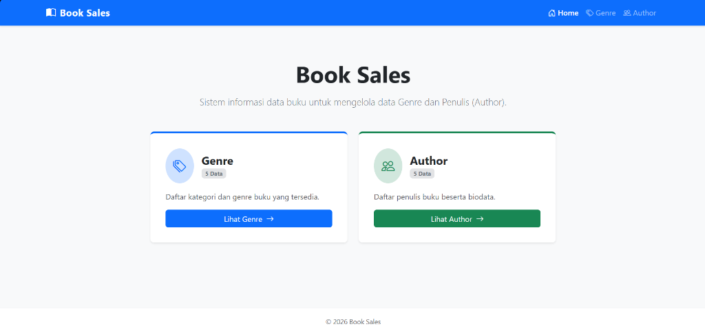
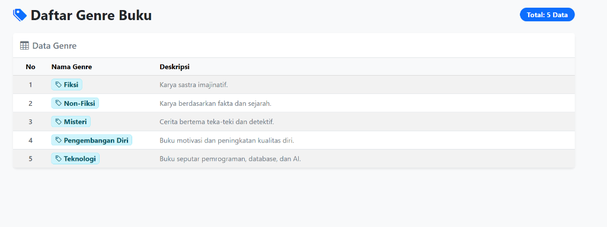
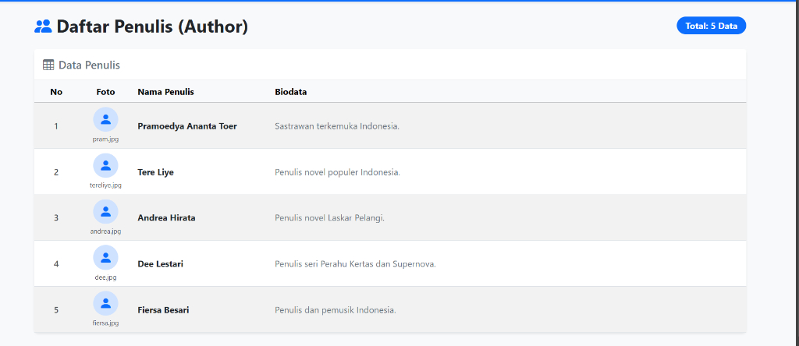

# Book Sales (booksales-api)

Aplikasi pengelolaan data penjualan buku dan katalog berbasis framework Laravel dengan implementasi arsitektur **Model-View-Controller (MVC)**.

---

## 📋 Prasyarat Sistem

Sebelum menjalankan proyek ini, pastikan sistem Anda telah terinstal software berikut:
* **PHP**: `>= 8.2` (dengan ekstensi `zip`, `pdo`, `mbstring`, `fileinfo` aktif di `php.ini`)
* **Composer**: `>= 2.x`
* **Git**: versi terbaru
* **Database**: MySQL / MariaDB (XAMPP / Laragon)

---

## 🚀 Langkah Instalasi & Menjalankan Proyek

### 1. Clone Repositori & Masuk Direktori
```bash
git clone https://github.com/abell56/tugas-laravel.git
cd booksales-api
```

### 2. Instalasi Dependensi PHP
```bash
composer install
```

### 3. Konfigurasi Lingkungan (.env)
Salin file `.env.example` menjadi `.env` (jika belum ada) dan sesuaikan konfigurasi database:
```env
DB_CONNECTION=mysql
DB_HOST=127.0.0.1
DB_PORT=3306
DB_DATABASE=db_penjualan_buku
DB_USERNAME=root
DB_PASSWORD=

SESSION_DRIVER=file
QUEUE_CONNECTION=sync
CACHE_STORE=file
```

Generate application key:
```bash
php artisan key:generate
```

### 4. Menjalankan Server Lokal
Jalankan development server Laravel:
```bash
php artisan serve
```
Akses aplikasi melalui browser di: `http://127.0.0.1:8000`

---

## 📁 Implementasi RESTful API

Proyek ini telah dialihkan ke arsitektur **RESTful API** berbasis JSON untuk entitas **Genre**, **Author**, dan **Book**:

```
[ Client / Postman ]
        │
        ▼ (HTTP GET Request)
[ routes/api.php ] (/api/...)
        │
        ▼
[ Controllers ] ──(Ambil Data)──► [ Models (Database / Eloquent) ]
 (GenreController, AuthorController,   (Genre.php, Author.php, Book.php)
  BookController)
        │
        ▼ (Return JSON Response)
[ JSON Output (HTTP 200 OK) ]
```

### 1. Model (`app/Models/`)
* **`Genre.php`**: Model Eloquent untuk tabel `genres` (`id`, `name`, `description`) dengan relasi `books()`.
* **`Author.php`**: Model Eloquent untuk tabel `authors` (`id`, `name`, `photo`, `bio`) dengan relasi `books()`.
* **`Book.php`**: Model Eloquent untuk tabel `books` (`id`, `description`, `price`, `stock`, `cover_photo`, `genre_id`, `author_id`) dengan relasi `author()` dan `genre()`.

### 2. Controller (`app/Http/Controllers/`)
* **`GenreController.php`**: Mengambil seluruh data dari `Genre::all()` dan mengembalikan output JSON.
* **`AuthorController.php`**: Mengambil seluruh data dari `Author::all()` dan mengembalikan output JSON.
* **`BookController.php`**: Mengambil seluruh data dari `Book::with(['author', 'genre'])->get()` dan mengembalikan output JSON.

### 3. File Routing (`routes/api.php`)
Seluruh routing endpoint data dipindahkan ke `routes/api.php` dan terdaftar otomatis dengan prefiks `/api`.

---

## 🌐 Daftar Endpoint API

| Endpoint | Method | Controller & Method | Format Output | Deskripsi |
| :--- | :---: | :--- | :---: | :--- |
| `/api/books` | `GET` | `BookController@index` | `JSON` | Menampilkan seluruh data Buku beserta relasi Penulis & Genre |
| `/api/authors` | `GET` | `AuthorController@index` | `JSON` | Menampilkan seluruh data Penulis (Author) |
| `/api/genres` | `GET` | `GenreController@index` | `JSON` | Menampilkan seluruh data Kategori / Genre Buku |

---

## 🗄️ Database Migration & Seeder

Struktur tabel dan data awal (dummy) telah disediakan melalui fitur Laravel Migration dan Seeder:

### 1. File Migration (`database/migrations/`)
* `2026_10_26_000001_create_genres_table.php`
* `2026_10_26_000002_create_authors_table.php`
* `2026_10_26_000003_create_books_table.php`

### 2. File Seeder (`database/seeders/`)
* `GenreSeeder.php`: Memuat 5 data dummy kategori buku.
* `AuthorSeeder.php`: Memuat 5 data dummy penulis buku.
* `BookSeeder.php`: Memuat 5 data dummy buku (Bumi Manusia, Bumi, Laskar Pelangi, Perahu Kertas, Garis Waktu).
* `DatabaseSeeder.php`: Menjalankan seluruh seeder di atas secara terurut.

### 3. Perintah Eksekusi Migration & Seeding
```bash
php artisan migrate
php artisan db:seed
```

---

## 📸 Hasil Tampilan Aplikasi

### 1. Halaman Beranda (Home)


### 2. Halaman Daftar Genre


### 3. Halaman Daftar Penulis (Author)


---

## 📄 Struktur Direktori Utama
* `app/Http/Controllers/` - Kontroler API (`GenreController.php`, `AuthorController.php`, `BookController.php`).
* `app/Models/` - Model pengelola data (`Genre.php`, `Author.php`, `Book.php`, `User.php`).
* `routes/api.php` - Definisi endpoint RESTful API aplikasi.
* `routes/web.php` - Definisi rute root aplikasi.
